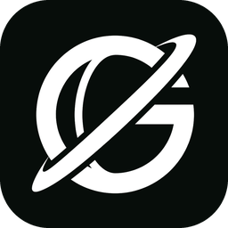
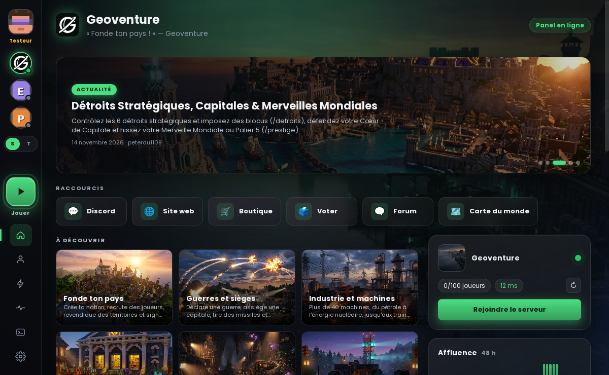
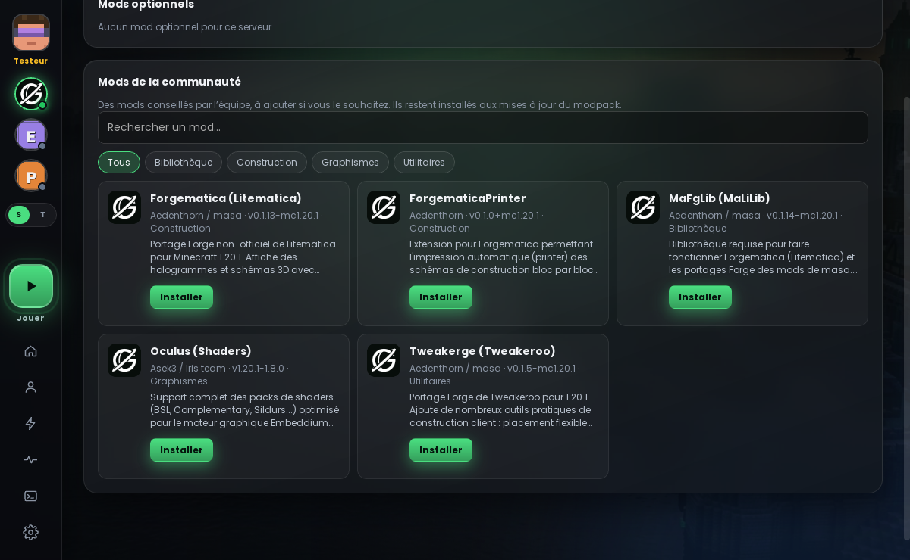
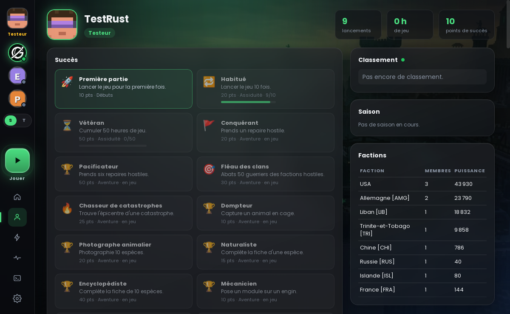

<div align="center">



# Geoventure Launcher

**Le launcher officiel du serveur Minecraft [Geoventure](https://geoventure.fr).**
Installe le jeu, Forge et le modpack en un clic, puis vous connecte directement au serveur.

[](https://github.com/Geoventure-MC/Launcher-v3/actions/workflows/rust-release.yml)


[](LICENSE.md)

[**Télécharger**](https://github.com/Geoventure-MC/Launcher-v3/releases) ·
[Site](https://geoventure.fr) ·
[Discord](https://discord.gg/VCmNXHvf77) ·
[Signaler un problème](https://github.com/Geoventure-MC/Launcher-v3/issues)



</div>

---

## Installation

Rendez-vous sur la page des [versions](https://github.com/Geoventure-MC/Launcher-v3/releases) et prenez la plus récente **« Geoventure Launcher v2.x »** :

| Système | Fichier | Remarque |
| --- | --- | --- |
| 🪟 **Windows 10 / 11** | `Geoventure.Launcher_x.y.z_x64-setup.exe` | Installation sans droits administrateur. |
| 🍎 **macOS** (Intel et Apple Silicon) | `Geoventure.Launcher_x.y.z_universal.dmg` | Première ouverture : clic droit sur l'app › **Ouvrir**. |
| 🐧 **Linux** | `.AppImage` ou `.deb` | AppImage : rendez-le exécutable, puis lancez-le. |

Le launcher se met ensuite **à jour tout seul**.

> **Vous aviez l'ancien launcher (Nexus) ?** Vous n'avez rien à faire : à sa prochaine ouverture, il installe le nouveau, vous garde connecté et l'ouvre. Vos mondes, mods et réglages du jeu sont conservés.

## Fonctionnalités

<table>
<tr>
<td width="50%" valign="top">

### 🎮 Jouer
- Minecraft **1.20.1**, **Java 17** et **Forge** installés automatiquement
- Modpack synchronisé et vérifié fichier par fichier
- Connexion directe au serveur, canaux **Stable** et **Test**
- Plusieurs serveurs : Geoventure, Elandor, Pokeland
- Vitesse et temps restant des téléchargements

</td>
<td width="50%" valign="top">

### 🩺 Fiabilité
- **Analyse des plantages** : cause probable et conseil (mémoire, Java, pilote graphique, mods…)
- **Diagnostic** en un clic, envoyé à l'équipe sans données personnelles
- Réparation de l'installation en un clic
- Journal du jeu et du launcher dans la console

</td>
</tr>
<tr>
<td valign="top">

### ⚡ Performances
- **Optimisation automatique** de la mémoire selon votre PC
- Profils **Économe**, **Équilibré**, **Performant**
- Détection de la carte graphique
- Réglages du jeu allégés pour les petites configurations (au choix)

</td>
<td valign="top">

### 🧩 Contenu
- **Mods de la communauté** installables en un clic
- **Shaders** (avec Oculus) et packs de ressources
- Galerie de **captures d'écran**
- Actualités, événements, affluence du serveur, Merveille

</td>
</tr>
<tr>
<td valign="top">

### 👤 Compte et profil
- Connexion avec votre compte [geoventure.fr](https://geoventure.fr), double authentification
- Session protégée dans le coffre-fort du système
- Succès, classements, saisons et factions

</td>
<td valign="top">

### ✨ Confort
- Présence **Discord**
- Icône près de l'horloge, ouverture au démarrage
- Notifications (maintenance, événements)
- Interface en **français** et en **anglais**

</td>
</tr>
</table>

<div align="center">


</div>

## Confidentialité

- Votre mot de passe n'est envoyé qu'au site Geoventure, en HTTPS, et n'est jamais enregistré.
- Les statistiques (lancements, plantages, durée de démarrage) ne sont envoyées **qu'avec votre accord**, sans texte libre ni donnée personnelle. Modifiable dans **Réglages › Jeu**.
- Les rapports de diagnostic masquent jetons, adresses e-mail et chemins de votre ordinateur, et ne partent que si vous cliquez sur « Envoyer ».

## Développement

Le launcher est écrit en **Rust** avec **[Tauri 2](https://tauri.app)** ; l'interface est en HTML, CSS et JavaScript, sans framework.

```text
src-tauri/   Rust : installation du jeu, Forge, modpack, connexion, plantages, mises à jour
frontend/    Interface : index.html, app.js, styles.css, i18n.js
tests/ui/    Tests de l'interface (Playwright, avec un faux pont Tauri)
```

**Prérequis :** [Rust](https://rustup.rs) stable et Node.js 20. Sous Linux : `libwebkit2gtk-4.1-dev libgtk-3-dev librsvg2-dev libayatana-appindicator3-dev`. Sous Windows : `scripts/install-rust.ps1`.

```bash
npm ci
npx tauri dev                                    # lancer en développement
cargo test --manifest-path src-tauri/Cargo.toml  # tests Rust
npm run test:ui                                  # tests de l'interface
```

Le launcher lit sa configuration (serveurs, modpack, annonces…) sur le [panel Geoventure](https://github.com/Geoventure-MC/panel).

<details>
<summary><b>Publication des versions (mainteneurs)</b></summary>

<br>

Chaque push sur `master` lance [`rust-release.yml`](.github/workflows/rust-release.yml) : tests, build Windows, macOS et Linux, puis une version `rust-v2.0.<n>`. Le launcher se met à jour en lisant `latest.json` dans la version `rust-latest`, signé avec le secret `TAURI_SIGNING_PRIVATE_KEY`.

- La version GitHub **« Latest » reste la dernière version de l'ancien launcher** : c'est elle qui fait passer les anciens launchers au nouveau. Les versions Rust sont publiées avec `--latest=false`.
- L'ancien launcher (Electron) est conservé sur la branche [`electron`](https://github.com/Geoventure-MC/Launcher-v3/tree/electron).
- Facultatif : le secret `DISCORD_RELEASE_WEBHOOK` annonce chaque version sur Discord.

</details>

## Licence

Distribué sous licence **[CC BY-NC 4.0](LICENSE.md)** : utilisation et modification libres, sans usage commercial, en citant Geoventure.

L'ancien launcher était basé sur le travail de [Luuxis](https://github.com/luuxis) et de CentralCorp.

<div align="center">
<sub>Fait avec ❤️ par l'équipe Geoventure · Minecraft est une marque de Mojang AB, ce projet n'est pas affilié à Mojang ni à Microsoft.</sub>
</div>
